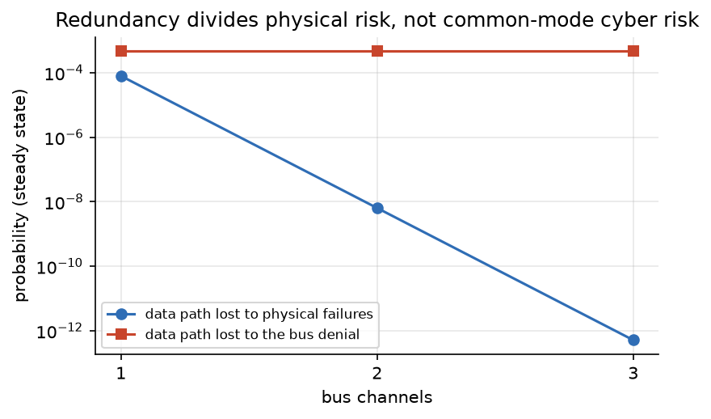

# Cyber attacks in reliability units

[](https://github.com/GMCavalheri/cyber-attack-reliability-impact-modeling/actions/workflows/ci.yml)

Reliability engineers measure a system in **MTBF, availability and mission-capable rate**.
Security engineers measure it in threats, incidents and controls. The two descriptions are
usually kept by different teams and rarely meet. This repository writes cyber attacks *as
failure modes*. Each attack is described by its effect on a system function, how often it
happens and how long the defenders take to detect and recover. From there it computes,
exactly and by simulation, what the attacks do to the metrics reliability engineers already
use. It is a quantitative answer to the question **Cyber-Informed Engineering (CIE)** puts to
engineering teams: what does cyber risk cost in the units you already manage?

The core is `cyberrel`, a small, typed Python package (NumPy, SciPy, matplotlib). It comes
with exact closed forms, an independent discrete-event simulation that confirms them, and a
six-lesson course that teaches it from first principles.



## Headline results (synthetic system, illustrative attack parameters)

The system is a generic, defense-representative navigation chain, the same one as in
[CPS-02](https://github.com/GMCavalheri/cyber-physical-rbd-attack-trees): two GNSS/INS units on
separate power buses feed a mission computer over a dual-channel data bus. The function is
*trusted navigation data reaches the mission computer*. Four attack scenarios are modelled at
the effect level: bus flooding, message delay or replay, false-message injection and GNSS
spoofing. Every number is reproduced by `validation/run_all.py`, and CI fails if any of them
changes.

| question | answer | where |
|---|---|---|
| Physical baseline | availability **0.9998**, system MTBF **19 870 h**; the mission computer causes 99.4 % of system failures; agrees with CPS-02's model to **1e-12** | [baseline](validation/results/baseline.md) |
| One attack as a failure mode | the bus flood reads **MTBF 2 000 h, MTTR 0.93 h**, and alone costs **2.3×** the unavailability of every physical failure combined | [translation](validation/results/translation.md) |
| All four attacks | availability **0.9987**; system MTBF falls **eighteenfold, to 1 087 h**; 85 % of not-mission-capable time is cyber | [translation](validation/results/translation.md) |
| Redundancy against common mode | a denial of the whole bus is **one block in series**: bus channels divide the physical risk (8e-5 → 6e-9 → 5e-13) and leave the attack's 4.6e-4 untouched | [translation](validation/results/translation.md) |
| A fleet, simulated | 24 platforms over 10 years: **1 790 cyber vs 95 physical** losses of the function; every simulated metric's 95 % interval contains the exact value | [combined](validation/results/combined.md) |
| Where mitigation matters | halving attack opportunities removes **42 %** of unavailability, a timing margin **34 %**, recovering twice as fast **23.5 %**, a second mission computer **15 %**; a third bus channel **0 %** | [sensitivity](validation/results/sensitivity.md) |
| Two levers | detection and recovery shorten outages but leave system MTBF at **1 087 h**; only hardening and engineered controls make losses rarer | [sensitivity](validation/results/sensitivity.md) |

The attack rates and times are **explicit, illustrative assumptions**, not threat data, so
the percentages are a worked example. The structural results hold for any parameters: the
series-block identity, detection as a duration-only lever, and redundancy paying only at the
physical single point of failure. Notebook 6 shows the ranking changing with the attack rates
while the third bus channel stays worthless. See [the report](docs/report.md) and
[scope](docs/scope.md).

## What is in it

| module | does |
|---|---|
| [`system_model`](src/cyberrel/system_model/) | repairable components, k-of-n structures with shared parts, the navigation system, exact availability, failure frequency, MTBF, mission reliability |
| [`metrics`](src/cyberrel/metrics/) | Fleet Reliability Dashboard KPIs from an outage log; FMC / PMC / NMC readiness with a physical/cyber cause split |
| [`attack_scenario_library`](src/cyberrel/attack_scenario_library/) | effect-level denial, integrity and delay scenarios, with detection, recovery and onset catch |
| [`attack_to_metric_translation`](src/cyberrel/attack_to_metric_translation/) | each attack as an alternating renewal process; exact joint physical and cyber metrics; ranking; the common-mode identity |
| [`combined_monte_carlo_simulation`](src/cyberrel/combined_monte_carlo_simulation/) | discrete-event fleet simulation by constant-state segments; outage logs; confidence intervals |
| [`sensitivity_analysis`](src/cyberrel/sensitivity_analysis/) | redundancy × detection grids, tornado over every parameter, mitigation comparison |

## Quickstart

```bash
git clone https://github.com/GMCavalheri/cyber-attack-reliability-impact-modeling
cd cyber-attack-reliability-impact-modeling
uv sync
uv run pytest --cov
uv run python validation/run_all.py
```

```python
from cyberrel.attack_scenario_library import load_scenarios
from cyberrel.attack_to_metric_translation import combined_steady_state, translate
from cyberrel.system_model import navigation_system

system = navigation_system()
scenarios = list(load_scenarios().values())
print(combined_steady_state(system).mtbf)  # 19 874 h, physical only
print(combined_steady_state(system, scenarios).mtbf)  # 1 087 h, with the four attacks
flood = translate(system, load_scenarios()["bus_flood_dos"])
print(flood.equivalent_mtbf, flood.equivalent_mttr)  # 2000 h, 0.93 h
```

## Documentation

* **Course:** [six lessons](docs/lessons/README.md), each with exercises and solutions, and an
  executed [notebook](notebooks/) per lesson.
* **Report:** [Cyber attacks in reliability units](docs/report.md): the findings, framed by
  Cyber-Informed Engineering, with their limits.
* **Related work:** [an honest comparison](docs/related-work.md) with operational security
  measures, MTTSF, time-to-compromise, ADVISE and power-system reliability under cyber attack:
  what is not new, and what is.
* **Reference notes:** one per module ([system model](docs/system_model.md),
  [metrics](docs/metrics.md), [scenarios](docs/attack_scenario_library.md),
  [translation](docs/attack_to_metric_translation.md),
  [simulation](docs/combined_monte_carlo_simulation.md),
  [sensitivity](docs/sensitivity_analysis.md)).
* **Scope:** [synthetic system, effect-level attacks, public sources only](docs/scope.md).

## Engineering

* 158 tests (pytest + Hypothesis), 99 % coverage with a 90 % gate. Every test asserts against
  a closed form, an independent computation (numerical integration, conditioning, CPS-02's
  `cpsrbd`, Monte Carlo against its own interval) or a cited value. Property tests check
  monotonicity in attack duration, detection, recovery and rate.
* An exact reduction: with attacks switched off the results equal the physical baseline. In
  the simulation this holds for each sample path, because random streams are keyed per
  process.
* `ruff`, strict `mypy`, CI on Python 3.11–3.13, gitleaks and pip-audit, Dependabot.
* A `reproduce` CI job reruns every validation script and fails if any committed result
  changes, then executes every notebook.
* **Not included, on purpose:** this is a library and a course, not a deployed service, so
  there is no staging environment, observability stack or feature-flag service.

## Deviations from the plan

* The plan expected to import metric modules from the Fleet Reliability Dashboard and from a
  Mission Capable Rate project. The dashboard keeps its formulas inside an application, so
  they are re-implemented here and tied to it by its own known-answer test. The Mission
  Capable Rate project has not been built, so the public readiness definitions live in
  `cyberrel.metrics`. The plan's `external/` folder is not needed.
* The synthetic system is CPS-02's navigation chain (the plan says the two projects share
  one), with repair times added. A test pins `cpsrbd` v1.0.0 and checks that both projects
  give the same physical mission unreliability.
* The ATT&CK for ICS extension is folded into the scenario library, as tags on effect-level
  scenarios. The maintenance-optimization extension is left as future work.
* Added beyond the plan: an optional parallel mission computer (so that a physical mitigation
  can compete fairly), a related-work review, and the honest novelty statement in Lesson 6.

## Licence

MIT. See [LICENSE](LICENSE).
