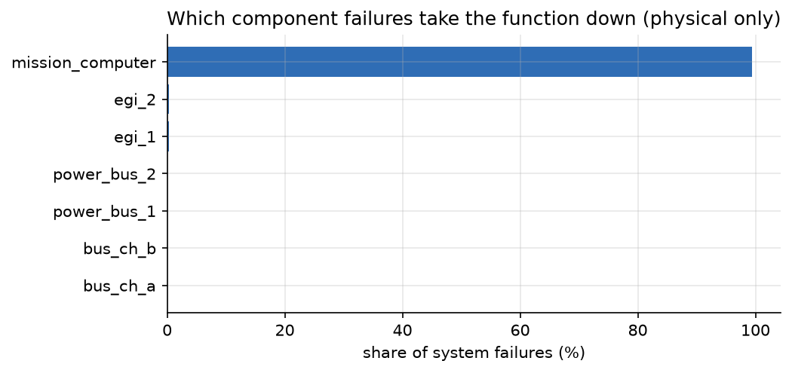

# Lesson 1 · One language for failure: MTBF, availability and readiness

> Before we can say what a cyber attack *costs* a system in reliability terms, we need the
> reliability terms themselves, defined precisely enough that a physical failure and a cyber
> outage can be dropped into the same formula. This lesson builds that vocabulary on the
> project's synthetic system: MTBF, MTTR and availability for one component and for a whole
> redundant architecture, mission reliability, and the readiness statuses (FMC, PMC, NMC)
> that defense fleets report. Everything is physical-only here. The baseline must be right
> before we disturb it.

**Code:** [`src/cyberrel/system_model/`](../../src/cyberrel/system_model/),
[`src/cyberrel/metrics/`](../../src/cyberrel/metrics/) ·
**Tests:** [`tests/test_system_model.py`](../../tests/test_system_model.py),
[`tests/test_metrics.py`](../../tests/test_metrics.py),
[`tests/test_cpsrbd_crosscheck.py`](../../tests/test_cpsrbd_crosscheck.py) ·
**Results:** [`validation/results/baseline.md`](../../validation/results/baseline.md) ·
**Next:** [Lesson 2](02-describing-an-attack-by-what-it-does.md)

## Learning objectives

1. Define MTBF, MTTR and availability from an event log, and explain why
   $A = \mathrm{MTBF}/(\mathrm{MTBF} + \mathrm{MTTR})$ holds whatever the repair distribution.
2. Compute the availability of a redundant system with shared components by enumeration and
   by conditioning.
3. Explain why a *system's* MTBF is not any component's MTBF, and compute it from the
   failure frequency.
4. Distinguish steady-state availability from mission reliability.
5. State the public FMC / PMC / NMC definitions and map a reliability model onto them.

---

## 1. One component: an alternating renewal process

A repairable unit alternates between *up* periods $U_1, U_2, \dots$ and *down* periods
$D_1, D_2, \dots$. We take the up periods exponential with rate $\lambda$ (a constant
hazard, the usual model for electronics in their useful life) and the down periods i.i.d.
with mean MTTR and any shape. Then

```math
\mathrm{MTBF} = E[U] = \frac{1}{\lambda},
\qquad
A = \lim_{T \to \infty} \frac{\text{time up in } [0, T]}{T}
  = \frac{E[U]}{E[U] + E[D]}
  = \frac{\mathrm{MTBF}}{\mathrm{MTBF} + \mathrm{MTTR}} .
```

The last step is the **renewal-reward theorem**: each up-down cycle is a renewal, the
"reward" is the up time in the cycle, and the long-run average reward per unit time is the
expected reward per cycle over the expected cycle length. Only *means* appear, which is why
the formula does not care whether repairs are exponential, lognormal or fixed. (The repair
shape will matter later, for how long outages last and how they overlap.)

### The same formula from a log

The portfolio's Fleet Reliability Dashboard computes the same three numbers from maintenance
records:

```math
\mathrm{MTBF} = \frac{\text{operating hours}}{\text{number of failures}},
\qquad
\mathrm{MTTR} = \frac{\sum \text{repair hours}}{\text{number of failures}},
\qquad
A = \frac{\mathrm{MTBF}}{\mathrm{MTBF} + \mathrm{MTTR}} .
```

If the operating hours are the hours the unit was up, both MTBF and MTTR share the factor
$1/n$, and $A$ is exactly the fraction of time up. That identity is what lets us put a cyber
outage in the same log later: it is one more down interval, with a cause attached.

`reliability_kpis` reproduces the dashboard's own known-answer test: three failures with 4, 2
and 6 repair hours over 150 flight hours give MTBF 50 h, MTTR 4 h and $A = 50/54$.

## 2. From components to a system

The synthetic system is CPS-02's navigation chain: a generic, defense-representative
platform, with no real system modelled. Two embedded GNSS/INS units (EGI), each powered from
its own electrical bus, publish navigation solutions on a dual-channel data bus to a mission
computer, which is fed from both buses. Its function is *trusted navigation data reaches the
mission computer*. In success logic:

```math
\phi = \bigl[(e_1 \wedge p_1) \vee (e_2 \wedge p_2)\bigr]
       \wedge (c_a \vee c_b) \wedge m \wedge (p_1 \vee p_2)
```

with $x = 1$ meaning "up". The power buses $p_1, p_2$ appear twice, so the blocks are not
independent and the series-parallel shortcut (multiply the blocks' availabilities) is
wrong. Two exact ways out:

* **Enumeration.** Components are independent, so each of the $2^7 = 128$ states
  has probability $\prod_i A_i^{x_i}(1 - A_i)^{1 - x_i}$. Sum the probabilities of the states
  where $\phi = 1$. `works_probability` does this with NumPy, one column per component.
* **Conditioning (pivoting)** on the shared components, which is how
  `test_navigation_availability_by_conditioning_on_the_power_buses` builds an independent
  oracle:

```math
A_{\text{sys}} = A_m \bigl[1 - (1 - A_{c_a})(1 - A_{c_b})\bigr]
\Bigl[ A_{p_1} A_{p_2} \bigl(1 - (1 - A_{e_1})(1 - A_{e_2})\bigr)
     + A_{p_1}(1 - A_{p_2}) A_{e_1} + (1 - A_{p_1}) A_{p_2} A_{e_2} \Bigr]
```

Both give $A = 0.9998$ (unavailability $2.005 \times 10^{-4}$), agreeing to $10^{-12}$.

## 3. The system's MTBF is not a component's MTBF

The system is up a fraction $A$ of the time, but how *often* does it fail? It fails exactly
when some component fails *while it is critical*, that is, when the system works with it and
would not work without it. In steady state component $i$ fails with frequency $\nu_i$, one failure per up-down cycle,
so $\nu_i$ is the reciprocal of its MTBF plus its MTTR; and it is critical with probability
equal to its **Birnbaum importance** $I_B(i) = P(\phi(1_i, X) = 1) - P(\phi(0_i, X) = 1)$.
Components are independent, so

```math
\omega = \sum_i \nu_i \, I_B(i),
\qquad
\mathrm{MTBF}_{\text{sys}} = \frac{A}{\omega},
\qquad
\mathrm{MDT}_{\text{sys}} = \frac{1 - A}{\omega} .
```

(Rausand & Høyland, ch. 13.) The last two follow because system up and down periods
alternate: in a long time $T$ there are about $\omega T$ cycles, sharing $AT$ hours of up time
and $(1 - A)T$ hours of down time.

**Check on a parallel pair.** For two identical units with exponential repair at rate $\mu$,
the system is down only when both are, and it leaves that state at rate $2\mu$. So the mean
down time is $1/(2\mu) = \mathrm{MTTR}/2$. With $A$ the availability of one unit, the formula gives
$\omega = 2 \lambda A (1 - A)$ and $\mathrm{MDT} = (1 - A)^2/\omega = \mathrm{MTTR}/2$ as well;
`test_parallel_pair_markov_result` checks it. Redundancy does two things here: it makes system
failures rare, and it makes them *short*, because the system comes back when the first of the
two repairs finishes.

**On the navigation system:** $\omega = 5.03 \times 10^{-5}$ per hour, so the system
MTBF is $1.99 \times 10^4$ h and the MDT is 4.0 h. The failure-share column of the results
table, $\nu_i I_B(i)/\omega$, shows where those failures come from. **The mission computer
causes 99.4 %**. It is the only unit without a redundant partner, and its own MTBF of
$2 \times 10^4$ h *is*, to three digits, the system MTBF. Duplicated units contribute almost
nothing, because both must be down at once.



## 4. Mission reliability is a different question

Availability is a long-run average over a platform that is repaired. A single mission asks
something else: *will the function survive the next 10 hours, with no repair in flight?*
Component $i$ survives with probability $e^{-\lambda_i t}$, and the system with
$P(\phi(X) = 1)$ under those probabilities:

```math
R_{\text{sys}}(t) = P\bigl(\phi(X) = 1\bigr), \quad P(X_i = 1) = e^{-\lambda_i t} .
```

For $t = 10$ h, $1 - R = 5.05 \times 10^{-4}$.

**Cross-check with CPS-02.** CPS-02 computes exactly this number by a different route: a
failure-logic DAG with Shannon decomposition, its physical-only view. The test
`test_physical_mission_unreliability_matches_cps02` installs `cpsrbd` v1.0.0 and checks that the
two agree to $10^{-12}$ for 1, 10 and 100 h missions. Two implementations of the same system,
written in two "languages" (success logic here, failure logic there), give one number. The
series rests on this.

## 5. Readiness: FMC, PMC and NMC

Defense fleets report readiness rather than dispatch reliability. The public definitions
(GAO-03-300, 2003; GAO-23-106217, 2022; USAF reporting is governed by DAFI 21-103) are:

* **FMC**, full mission capable: the unit has every mission-essential system it needs for
  *all* its missions.
* **PMC**, partial mission capable: it can perform *at least one* of its missions, but not all.
* **MC = FMC + PMC.** The MC rate is the share of time the unit can fly at least one
  mission: hours in the status over the hours it could have been available (possessed hours).
* **NMC** is the rest. Services split it by cause, maintenance (NMCM) or supply (NMCS).

A reliability model does not come with mission lists, so the mapping is a stated modelling
choice:

| model state | status |
|---|---|
| every component up, no cyber effect active | FMC |
| function up, some redundancy lost | PMC |
| function down | NMC (attributed to physical, cyber or both) |

We assume spares are always on hand, so there is no NMCS. Then MC rate equals the function's
availability, and the FMC share is $\prod_i A_i$, the probability that nothing at all is down.
For the baseline: FMC 0.9982, PMC 0.0016 and NMC $2.0 \times 10^{-4}$.

**A useful paradox** is in the redundancy table of the results. Adding a third EGI barely
changes NMC (from $2.005 \times 10^{-4}$ to $2.001 \times 10^{-4}$), but *raises* PMC (from
0.0016 to 0.0022). More boxes mean more boxes that can be in the shop. Redundancy buys
mission capability by spending full mission capability, and readiness metrics show it, where
a single availability number would not.

## 6. Code walkthrough

```python
from cyberrel.system_model import (
    mission_reliability,
    navigation_system,
    steady_state,
    steady_state_status,
)

system = navigation_system()  # CPS-02's architecture: 2 EGI, 2 bus channels
print(system.summary())  # series(parallel(series(egi_1, power_bus_1), ...), ...)
s = steady_state(system)  # A, omega, MTBF = A/omega, MDT = (1 - A)/omega
print(s.availability, s.mtbf, s.mdt)
print(1 - mission_reliability(system, 10.0))  # one 10 h mission, no repair
status = steady_state_status(system)  # probabilities of FMC / PMC / NMC
print(status.mc_rate, status.fmc_rate)
print(steady_state(navigation_system(egi_units=3)).mtbf)  # a redundancy variant
```

* `Component` holds λ and a `RepairDistribution` (lognormal by default, the conventional shape
  for corrective-maintenance times). `KOutOfN`, `Series` and `Parallel` build the structure,
  and a name may appear under several blocks.
* `closed_form.enumerate_states` lists all $2^n$ states as boolean columns, and
  `structure.evaluate` applies $\phi$ to all of them at once.
* `metrics.reliability_kpis` is the dashboard formula. `metrics.readiness.classify` maps
  states (or, later, simulated intervals) to statuses.

## 7. Where the plan said "reuse"

The plan expected to import metric modules from two earlier projects. The Fleet Reliability
Dashboard keeps its formulas inside a Streamlit application, not an importable package, so they
are re-implemented here and tied to it by its own known-answer test. The Mission Capable Rate
project was never built, so the public readiness definitions live in `cyberrel.metrics`
instead. Neither choice changes a formula.

## Exercises

1. A unit has MTBF 2000 h and MTTR 5 h. What is its availability, and how many hours a year
   (8760 h) is it down on average?
2. A maintenance log shows 4 failures with repair times of 2, 3, 5 and 10 h over 1000 operating
   hours. Compute MTBF, MTTR and A with the dashboard formulas.
3. A squadron of 10 aircraft is possessed for 30 days. It logs 6000 FMC hours, 700 PMC hours
   and 500 NMC hours. What are its MC and FMC rates?
4. The mission computer alone has $\lambda = 5 \times 10^{-5}$ per hour. What is its 10 h
   mission unreliability, and what fraction of the system's $5.05 \times 10^{-4}$ is it?
5. In the parallel-pair example, repairs take a *fixed* time $r$ instead of an exponential
   one, and $\lambda r \ll 1$. Argue that the system MDT is still about $r/2$.
6. Why does a third EGI raise the PMC rate but hardly lower the NMC rate? What *would* lower
   NMC substantially?

### Solutions

1. $A = 2000/2005 = 0.99751$. Down time is $8760 \times 5/2005 = 21.8$ h per year.
2. MTBF = 1000/4 = 250 h; MTTR = 20/4 = 5 h; $A = 250/255 = 0.9804$.
3. Possessed hours: $10 \times 720 = 7200$. MC rate = $6700/7200 = 0.931$; FMC rate =
   $6000/7200 = 0.833$.
4. $1 - e^{-5 \times 10^{-4}} = 5.00 \times 10^{-4}$, which is about 99 % of the system's
   value. The rest comes from both data sources or both data paths being lost.
5. The system fails when the second unit fails during the first unit's repair. With
   $\lambda r \ll 1$ that failure time is close to uniform over the repair, so the residual
   repair time of the first unit is uniform on $(0, r)$, with mean $r/2$. The second unit's
   own repair, of length $r$, always ends later.
6. NMC is dominated by the unduplicated mission computer (99.4 % of system failures), which a
   third EGI does not touch, while the extra unit adds one more box that can be down while
   the function is up. A second mission computer, or a shorter mission-computer MTTR, would
   lower NMC.

## References

* M. Rausand and A. Høyland, *System Reliability Theory: Models, Statistical Methods, and
  Applications*, 2nd ed., Wiley, 2004: alternating renewal processes and availability (ch. 7),
  structure functions and k-out-of-n (ch. 3–4), and system failure frequency (ch. 13).
* S. M. Ross, *Introduction to Probability Models*, 11th ed., Academic Press, 2014: the
  renewal-reward theorem (ch. 7, renewal theory).
* U.S. GAO, *Military Readiness: DOD Needs a Clear and Defined Process for Setting Aircraft
  Availability Goals in the New Security Environment*, GAO-03-300, April 2003 (FMC, PMC, MC).
* U.S. GAO, *Weapon System Sustainment: Aircraft Mission Capable Goals Were Generally Not Met
  and Sustainment Costs Varied by Aircraft*, GAO-23-106217, November 2022.
* Department of the Air Force, DAFI 21-103, *Equipment Inventory, Status and Utilization
  Reporting*.
* CPS-02, *Unified RBD + attack tree framework* (GMCavalheri/cyber-physical-rbd-attack-trees),
  v1.0.0: the same synthetic system in failure logic.
