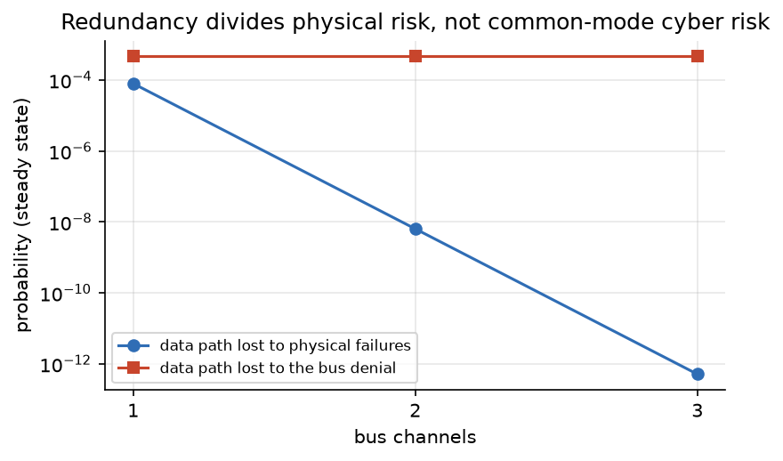
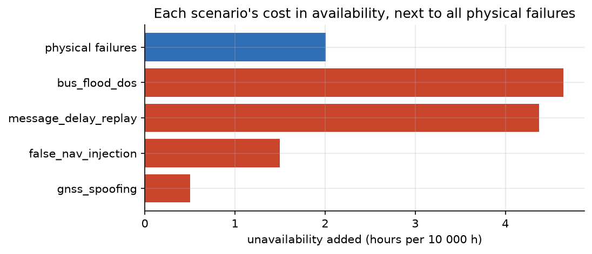

# Lesson 3 · A cyber attack as a failure event

> This is the lesson the project exists for. We take each attack scenario from Lesson 2 and
> treat it *exactly* as reliability engineering treats a failure mode. It gets a mean time
> between occurrences and a mean outage length, it enters the system structure where its
> effect lands, and out come the same availability, MTBF and mission-capable rate as in
> Lesson 1. Once attacks are in those units, a reliability engineer can compare them with
> physical failures on one table. That table also shows something no single-team analysis
> shows: redundancy that crushes physical risk does nothing against a common-mode attack.

**Code:** [`src/cyberrel/attack_to_metric_translation/`](../../src/cyberrel/attack_to_metric_translation/) ·
**Tests:** [`tests/test_translation.py`](../../tests/test_translation.py) ·
**Results:** [`validation/results/translation.md`](../../validation/results/translation.md) ·
**Previous:** [Lesson 2](02-describing-an-attack-by-what-it-does.md) ·
**Next:** [Lesson 4](04-the-total-risk-picture.md)

## Learning objectives

1. Model an attack scenario as an alternating renewal process, and compute its equivalent
   MTBF, its equivalent MTTR and its stationary probability of denying the function.
2. Combine independent physical and cyber processes on one structure function, exactly.
3. Extend the system failure-frequency formula to attack onsets.
4. Prove that a denial of a whole necessary group acts as a single block in series, and
   explain why redundancy inside the group does not help.
5. Read an attack ranking in reliability units, including what availability alone hides.

---

## 1. The attack as an alternating process

Between episodes a scenario is *idle*. New attacks arrive at rate $\lambda_a$, so idle periods
are exponential with mean $1/\lambda_a$. Each arrival starts an episode that denies the target
with probability $p$ (mean length $L_d$) or only degrades it (mean length $L_g$), as in Lesson 2.
That is an alternating renewal process with two kinds of "down". The renewal-reward theorem,
the same one that gave $A = \mathrm{MTBF}/(\mathrm{MTBF} + \mathrm{MTTR})$ in Lesson 1, gives

```math
C = \frac{1}{\lambda_a} + p L_d + (1 - p) L_g,
\qquad
P(\text{deny}) = \frac{p L_d}{C},
\qquad
P(\text{degrade}) = \frac{(1 - p) L_g}{C},
\qquad
\nu_a = \frac{p}{C}
```

where $C$ is the mean cycle length and $\nu_a$ the long-run frequency of denial onsets.

This is the **translation**. In a failure-mode table the scenario appears with

```math
\mathrm{MTBF}_{\text{eq}} = \frac{1 - P(\text{deny})}{\nu_a},
\qquad
\mathrm{MTTR}_{\text{eq}} = L_d ,
```

and the equivalent MTBF over the sum of the two is $1 - P(\text{deny})$, exactly as for a
component. For the bus flood ($\lambda_a = 5 \times 10^{-4}$/h,
$L_d = 0.93$ h) the table reads **MTBF 2000 h, MTTR 0.93 h**. For false-message injection,
only half the episodes deny, and the degrading ones also take time, so the equivalent MTBF
is 20 002 h, not $1/\lambda_a = 10000$ h.

The Monte Carlo section of the results samples 200 timelines of $2 \times 10^5$ h per scenario.
The share of time denied lands within two standard errors of $P(\text{deny})$ for all four
scenarios.

## 2. One structure, two kinds of process

Physical component $i$ is up with probability $A_i$. Scenario $s$ is idle, degrading or
denying with the probabilities above. While $s$ denies its target group $G_s$, every
component of $G_s$ counts as down. The function is $\phi$ of the **effective** states:

```math
\tilde x_i = x_i \wedge \neg \bigvee_{s : i \in G_s} \text{deny}_s,
\qquad
\text{function up} \iff \phi(\tilde x) = 1 .
```

All the processes are independent (attacks do not cause hardware failures, and the other
way round), so the stationary distribution of the joint state is the product of the
marginals. `combined_steady_state` enumerates it: $2^7$ component states times $3^4$
scenario states, 10 368 joint states. Then it sums probabilities, exactly as in Lesson 1. With
no scenarios it reduces to the Lesson 1 baseline to $10^{-12}$; a test checks this.

**Failure frequency.** The criticality argument carries over unchanged. The function fails
when a component fails while it is critical, *or when a denial starts while the scenario is
critical*:

```math
\omega = \sum_i \nu_i \, P(i \text{ critical}) + \sum_s \nu_s \, P(s \text{ critical}),
\qquad
\mathrm{MTBF} = \frac{A}{\omega},
\qquad
\mathrm{MDT} = \frac{1 - A}{\omega} .
```

The smallest check, `test_failure_frequency_of_two_processes_in_series`, has one component
$a$ and one denial of its group. The function fails when $a$ fails while not denied, or when
a denial starts while $a$ is up: $\omega = \nu_a (1 - q) + \nu_s A_a$, with $q = P(\text{deny})$.

## 3. Common mode: the attack is one block in series

**Claim.** Suppose a scenario denies a group $G$ that the function cannot do without (with
every member of $G$ down, $\phi = 0$). Then

```math
A_{\text{attacked}} = A_{\text{physical}} \cdot \bigl(1 - P(\text{deny})\bigr),
```

whatever the redundancy inside $G$.

**Proof.** When the scenario denies, every member of $G$ is effectively down, so the function
is down. When it does not deny, $\tilde x = x$ and the function is up exactly when
$\phi(x) = 1$. So "function up" is the event $\{\phi(x) = 1\} \cap \{\text{not denied}\}$, and
the two are independent. $\square$

The attack therefore enters the reliability block diagram as **one more block in series**,
with availability $1 - P(\text{deny})$. The redundancy *inside* the group never sees it.
`test_common_mode_denial_is_one_series_block` checks the identity for one, two and three bus
channels and three different scenarios.

The results table shows what this means in numbers:

| bus channels | data path lost, physical | data path lost, bus denial |
|---|---|---|
| 1 | $8.0 \times 10^{-5}$ | $4.6 \times 10^{-4}$ |
| 2 | $6.4 \times 10^{-9}$ | $4.6 \times 10^{-4}$ |
| 3 | $5.1 \times 10^{-13}$ | $4.6 \times 10^{-4}$ |



Each added channel multiplies the physical risk by $q \approx 8 \times 10^{-5}$. The bus
denial does not move. This is the quantitative core of why Cyber-Informed Engineering talks
about engineered controls, design simplification and interdependency evaluation, and not
only about adding copies. A copy that shares the attacked medium is not a copy for the
attacker. (CPS-04 in this series studies common-cause cyber failure of redundancy in depth.)

## 4. The ranking, in reliability units

| case | 1 − A | added ÷ physical | system MTBF (h) | MDT (h) | MC rate |
|---|---|---|---|---|---|
| physical only | $2.0 \times 10^{-4}$ | — | 19 870 | 4.0 | 0.9998 |
| + bus flood | $6.6 \times 10^{-4}$ | 2.3 | 1 817 | 1.2 | 0.9993 |
| + delay / replay | $6.4 \times 10^{-4}$ | 2.2 | 2 855 | 1.8 | 0.9994 |
| + false-message injection | $3.5 \times 10^{-4}$ | 0.75 | 9 969 | 3.5 | 0.9996 |
| + GNSS spoofing | $2.5 \times 10^{-4}$ | 0.25 | 14 220 | 3.6 | 0.9997 |
| + all four | $1.3 \times 10^{-3}$ | 5.5 | 1 087 | 1.4 | 0.9987 |



Four readings, each one an argument for the shared language:

1. **The bus flood alone costs 2.3 times as much availability as every physical failure
   combined.** With the illustrative rates, cyber effects are the larger risk to this function.
   The *ranking* comes from structure and timing, not from a forecast, and it moves
   predictably when you change the assumptions.
2. **Availability hides frequency.** The bus flood raises unavailability 3.3-fold but cuts
   system MTBF elevenfold, from 19 870 h to 1 817 h. Its outages are short (0.93 h) and
   frequent, so the system fails far more often while each loss is brief. A mission planner
   cares about how *often* the function drops out during a sortie, which availability alone
   does not show.
3. **The system's MDT falls** from 4.0 h to 1.4 h with all four scenarios. This is not good
   news: short cyber outages now dominate the mix, and they *dilute* the mean.
4. **Integrity attacks are cheap in availability but not in FMC.** GNSS spoofing adds only a
   quarter of the physical unavailability, because the cross-check catches 90 %. But the
   caught episodes still degrade the system (PMC time), so its FMC cost
   ($2.3 \times 10^{-4}$) is more than four times its availability cost
   ($5.0 \times 10^{-5}$).

With all four scenarios, NMC time is 0.110 % cyber and 0.020 % physical. Only
$2.2 \times 10^{-7}$ of the time is NMC through *both* together (physical failures and an
attack overlapping), so at these rates the two risks nearly add. The interaction is small
here because each outage is rare and brief. CPS-02's "interaction gap" studies the case where
it is not, with mixed cut sets inside one mission.

## 5. Monotone by construction

The tests check, over random parameters (Hypothesis), that the availability lost to a
denial scenario never decreases when:

* the attack is sustained longer (larger mean $D$),
* detection or recovery is slower (larger $T_d$ or $T_r$), or
* attacks are more frequent (larger $\lambda_a$).

They also check that the delay scenario's loss is a monotone step in latency, and that a zero
rate gives exactly zero loss. This is the plan's validation criterion ("longer denial-of-service
duration → larger availability impact, monotonically") turned into a property that is tested
on every commit.

## 6. Code walkthrough

```python
from cyberrel.attack_scenario_library import load_scenarios
from cyberrel.attack_to_metric_translation import (
    combined_steady_state,
    common_mode_factor,
    rank_scenarios,
    scenario_process,
    translate,
)
from cyberrel.system_model import navigation_system

system = navigation_system()
lib = load_scenarios()
proc = scenario_process(lib["bus_flood_dos"])
print(proc.equivalent_mtbf, proc.equivalent_mttr, proc.p_deny)  # 2000 h, 0.93 h, 4.6e-4

impact = translate(system, lib["bus_flood_dos"])
print(impact.unavailability_multiple, impact.mtbf_ratio)  # 2.3, 0.091

every = combined_steady_state(system, list(lib.values()))
print(every.availability, every.mtbf, every.status.nmc_cyber)

print(common_mode_factor(navigation_system(bus_channels=3), lib["bus_flood_dos"]))  # 1 - P(deny)
for i in rank_scenarios(system, list(lib.values())):
    print(i.scenario, i.delta_availability)
```

* `episodes.scenario_process` implements Section 1, and `episodes.mean_min` gives the exact
  $E[\min(D, c)]$ for exponential, lognormal and fixed durations. It is tested against
  numerical integration.
* `combined.joint_states` builds the product distribution. `combined.function_up` applies
  denials to whole groups and then evaluates $\phi$.
* `translation.translate` and `rank_scenarios` produce the tables above.

## Exercises

1. A denial scenario has $\lambda_a = 10^{-3}$/h and a mean outage of 1 h, and every episode
   denies. Compute $P(\text{deny})$, the equivalent MTBF and the equivalent MTTR.
2. Why is the equivalent MTBF of `false_nav_injection` 20 002 h and not
   $1/\lambda_a = 10000$ h?
3. Repeat the common-mode proof for a scenario that denies only **one** of the two bus
   channels. What is the attacked availability of the data path?
4. Using the ranking table, by what factor does the bus flood raise system *unavailability*,
   and by what factor does it cut system *MTBF*? Why are they so different?
5. The four scenarios together leave $2.2 \times 10^{-7}$ of the time NMC "both". Describe a
   state that lands there.
6. A designer proposes a third bus channel to "protect against the bus flood". Using the
   results, give a one-sentence answer.

### Solutions

1. $C = 1000 + 1 = 1001$ h. $P(\text{deny}) = 1/1001 = 9.99 \times 10^{-4}$. Then
   $\nu_a = 1/1001$, the equivalent MTBF is $(1 - 1/1001) \times 1001 = 1000$ h and the
   equivalent MTTR is 1 h.
2. Only half the episodes deny ($p = 0.5$), so denials start half as often as attacks. The
   caught half still occupies time (degrading, mean 2 h), which lengthens the cycle. So
   the equivalent MTBF is $(1/\lambda_a + (1 - p) L_g)/p = (10000 + 1)/0.5 = 20002$ h.
3. The channel-A denial is independent of channel B. The data path is up when B is up, or
   when A is up and not denied: $1 - \bigl(1 - A_a (1 - q)\bigr)(1 - A_b)$. The attack's
   effect is multiplied by B's unavailability ($\approx 8 \times 10^{-5}$), so it is almost
   nothing. This is the case `test_partial_group_denial_by_hand` checks.
4. Unavailability: $6.649 \times 10^{-4} / 2.005 \times 10^{-4} = 3.3$. MTBF:
   $19870/1817 = 10.9$. The attack's outages (0.93 h) are much shorter than the physical
   ones (4.0 h), so many more failures fit in a smaller amount of down time.
5. The mission computer is in repair (that alone takes the function down) while a bus flood
   is active (that alone would too). Every library scenario denies a whole necessary group,
   so "both" here always means such an overlap. A state in which *only the combination*
   fails, such as one bus channel failed while an attack denies the other, would need a
   scenario that denies part of a group.
6. No: the flood denies the whole bus group, so a third channel leaves its 4.6 × 10⁻⁴ of
   denial untouched and only lowers a physical risk that is already $6.4 \times 10^{-9}$.

## References

* M. Rausand and A. Høyland, *System Reliability Theory*, 2nd ed., Wiley, 2004: system
  availability and failure frequency (ch. 13), common-cause failures (ch. 10).
* S. M. Ross, *Introduction to Probability Models*, 11th ed., Academic Press, 2014: renewal
  reward processes and alternating renewal processes (ch. 7).
* V. L. Wright *et al.*, *Cyber-Informed Engineering Implementation Guide*, INL/RPT-23-74072,
  2023 (principles 2, *engineered controls*, 4, *design simplification*, and 7,
  *interdependency evaluation*).
* CPS-02, *Unified RBD + attack tree framework* (GMCavalheri/cyber-physical-rbd-attack-trees):
  the interaction gap between physical and cyber views.
