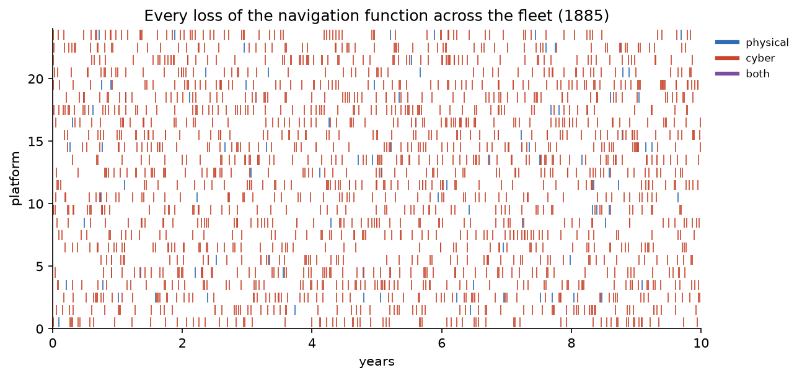
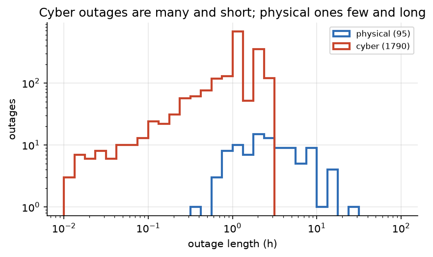

# Lesson 4 · The total risk picture

> Lesson 3 gave exact formulas. This lesson builds what a fleet would actually *record*: a
> discrete-event simulation of 24 platforms over ten years, with physical failures and attacks
> on the same timeline. Its output is an outage log that the Fleet Reliability Dashboard
> formulas can read. The simulation does three jobs: it validates the closed forms
> independently, it shows how noisy a real fleet history would be, and it produces the one
> picture that neither a reliability team nor a security team produces alone, the total
> risk to the function.

**Code:** [`src/cyberrel/combined_monte_carlo_simulation/`](../../src/cyberrel/combined_monte_carlo_simulation/) ·
**Tests:** [`tests/test_simulation.py`](../../tests/test_simulation.py) ·
**Results:** [`validation/results/combined.md`](../../validation/results/combined.md) ·
**Previous:** [Lesson 3](03-a-cyber-attack-as-a-failure-event.md) ·
**Next:** [Lesson 5](05-where-mitigation-money-matters.md)

## Learning objectives

1. Simulate alternating renewal processes efficiently and combine them on one structure with
   the *segment* method.
2. Turn a simulated history into an event log and into dashboard metrics.
3. Design random streams so that adding attacks cannot change the physical history, and use
   that for an exact reduction check.
4. Put honest confidence intervals on fleet metrics, and explain why a decade of fleet data
   says less about physical reliability than the closed form does.
5. Read the combined physical and cyber picture, and say what each team would miss alone.

---

## 1. Why simulate when we have exact formulas?

* **Independent validation.** The closed form rests on a chain of arguments: independence,
  renewal-reward and criticality. A simulation that shares none of that algebra, only the
  model's rules, and lands on the same numbers is strong evidence that both are right.
* **What a fleet would see.** Steady-state numbers are long-run averages. A finite fleet
  history scatters around them, sometimes a lot, and decision-makers see the scatter, not the
  average.
* **A log, not just a number.** The simulation produces outage records with causes and
  durations, the raw material of every reliability dashboard.
* **Room to grow.** Shared repair crews, coordinated attack campaigns and attacks that
  trigger physical damage all break the independence the closed form needs. The simulation
  can host them.

## 2. Timelines

For each component, `down_intervals` draws up times $U_k \sim \text{Exp}(\lambda)$ and repair
times $D_k$ in batches. Cycle ends are cumulative sums, $E_k = \sum_{j \le k} (U_j + D_j)$,
and down intervals are $[E_k - D_k, E_k)$. Every scenario's episode timeline is built the same
way (Lesson 3, Section 1): exponential idle periods, then deny or degrade episodes. Everything
starts "up and idle" at $t = 0$. The start-up transient lasts about one repair or episode
length, a few hours against a horizon of 87 600 h, so its bias is negligible.

## 3. The segment method

Collect every interval boundary of every process on one platform and sort them. Between two
consecutive boundaries *nothing changes*, so the platform's state is constant on each
**segment**. For each segment midpoint:

1. look up each component's state (binary search in its sorted down intervals) and each
   scenario's state (idle, degrade or deny);
2. apply denials to whole target groups and evaluate $\phi$, using exactly the
   `function_up` of the closed form;
3. classify FMC, PMC or NMC by cause with the same `classify`.

Status hours are then sums of segment lengths. There is no time step and no discretisation
error: the simulation is exact for its sample path. A ten-year history of one platform has a
few hundred segments, so the whole fleet runs in about a second.

**Outages.** Maximal runs of "function down" segments become `Outage(platform, start, end,
cause)` records. The cause is `physical` or `cyber` when every segment of the run has that
cause, and `both` otherwise. The dashboard formulas from Lesson 1 then read the log as they
would read a maintenance system's records.

## 4. Streams that cannot interfere

Each process draws from its own generator,
`SeedSequence(seed, spawn_key=(platform, kind, index))`. Adding a scenario therefore cannot
shift a single random number used by any component. Two consequences are tested:

* Scenarios with zero rate leave the outage log **identical**, record for record.
* In the attacked run, the hours in which *physical failures alone* would take the function
  down equal the physical-only run's down hours, **platform by platform**. The results table
  reports the largest difference over the 24 platforms: exactly 0.

This is the plan's validation criterion ("with zero cyber attack scenarios the framework
reduces to the physical baseline") in its strongest form. It holds for each sample path, not
just on average.

## 5. Confidence intervals, and the noise in a decade of data

Platforms are independent, so each one gives an independent estimate of every rate. The
fleet mean and a Student-$t$ interval with 23 degrees of freedom summarise them
(`FleetResult.estimate`). Against the exact steady state:

| case | metric | exact | simulated | 95 % interval |
|---|---|---|---|---|
| physical only | failure frequency (/h) | $5.03 \times 10^{-5}$ | $4.52 \times 10^{-5}$ | $[3.38, 5.66] \times 10^{-5}$ |
| physical + cyber | failure frequency (/h) | $9.19 \times 10^{-4}$ | $8.97 \times 10^{-4}$ | $[8.57, 9.36] \times 10^{-4}$ |
| physical + cyber | NMC share, cyber | $1.10 \times 10^{-3}$ | $1.07 \times 10^{-3}$ | $[1.01, 1.12] \times 10^{-3}$ |

All ten comparisons in the results land inside their intervals. Look at the width of the
physical-only one: **±25 %, after 2.1 million platform-hours**. Ten years of a 24-aircraft
fleet produce only 95 physical losses of this function, because the redundancy works. An
engineer who estimates this function's MTBF from fleet data alone gets a number good to about
a quarter. The closed form, built from component rates (which are themselves estimated from
much larger component-level data), is far tighter. That is a classic argument for system
modelling over system-level statistics in high-reliability systems, and it applies doubly to
cyber, where incident data are scarcer still.

The test suite uses 99.9 % intervals and fixed seeds, so each check is deterministic and a
correct simulation fails it about once in a thousand seeds.

## 6. The total risk picture

Fleet totals from the outage log (dashboard formulas):

| metric | physical only | physical + cyber |
|---|---|---|
| function-loss events | 95 | 1 885 |
| MTBF (h) | 22 130 | 1 114 |
| MTTR (h) | 4.04 | 1.39 |
| availability = MC rate | 0.9998 | 0.9988 |
| FMC rate | 0.9983 | 0.9969 |



By cause, the attacked fleet logs **1 790 cyber outages** (MTBF 1 173 h, MTTR 1.25 h) against
**95 physical** ones (MTBF 22 100 h, MTTR 4.0 h), and none labelled "both". The exact share of
"both" time is $2.2 \times 10^{-7}$, about 0.46 h in 2.1 million hours, so seeing none is what
we expect.



Now imagine the usual split of responsibilities:

* The **reliability team** reports availability 0.9998 and an MTBF of 22 000 h for the
  navigation function. Both are true for physical failures, and both are wrong for the
  function.
* The **security team** reports 1 790 detected incidents over ten years, a count with no
  unit of mission impact.
* **Neither** reports that the function the aircraft needs fails about once every 1 100 hours,
  that 85 % of its NMC time is cyber, or that a third bus channel would buy nothing against
  most of it.

The combined model is the bridge Cyber-Informed Engineering asks for: one model and one log,
reported in the units the engineers already use.

## 7. Code walkthrough

```python
from cyberrel.attack_scenario_library import load_scenarios
from cyberrel.combined_monte_carlo_simulation import simulate_fleet
from cyberrel.system_model import navigation_system

system = navigation_system()
scenarios = list(load_scenarios().values())
fleet = simulate_fleet(system, scenarios, platforms=24, horizon=10 * 8760.0, seed=20261115)

print(fleet.kpis())  # dashboard MTBF, MTTR, availability from the outage log
print(fleet.kpis({"cyber"}).mttr)  # by cause
print(fleet.estimate("availability"))  # mean and 95 % interval across platforms
print(fleet.status.mc_rate, fleet.status.fmc_rate)
print(fleet.outages[:3])  # Outage(platform, start, end, cause)
```

## Exercises

1. The exact failure frequency with physical failures only is $5.03 \times 10^{-5}$/h. How
   many function losses do you expect in 2 102 400 platform-hours? Is 95 surprising?
2. Repeat with attacks ($9.19 \times 10^{-4}$/h) against the 1 885 observed.
3. Check the dashboard identity on the attacked fleet: compute
   $\mathrm{MTBF}/(\mathrm{MTBF} + \mathrm{MTTR})$ from the table and compare it with the
   availability.
4. Why are confidence intervals computed across *platforms* rather than across outages?
5. Suppose an adversary attacks **all platforms at once** (a fleet-wide campaign). Which
   modelling assumption breaks, and which fleet metric would the current model most
   misjudge?
6. Why does each process get its own random stream instead of one generator for everything?

### Solutions

1. $5.03 \times 10^{-5} \times 2.1024 \times 10^{6} = 105.8$. Function losses are close to a
   Poisson count, with a standard deviation of about $\sqrt{106} = 10.3$. So 95 is about 1.05
   standard deviations low, which is unremarkable.
2. $9.19 \times 10^{-4} \times 2.1024 \times 10^{6} = 1932$, with a standard deviation of
   about 44. 1 885 is about 1.1 standard deviations low.
3. $1114/(1114 + 1.391) = 0.99875$, which matches the availability 0.9988. The identity is
   exact because operating hours are up hours (Lesson 1).
4. Outages on one platform share that platform's history. While a unit is in repair, for
   example, it cannot fail again, and a function already down cannot be lost again. So
   outages are not independent draws. Platforms are independent by construction, so
   per-platform rates are i.i.d. and the $t$ interval is valid.
5. Independence *between platforms*. The mean MC rate would still be right if the per-platform
   rates were unchanged, but the fleet would lose many platforms at the *same* time. The
   distribution of how many platforms are mission-capable at a given moment (fleet
   readiness for a surge) would be badly misjudged. Lesson 6 lists this as a limitation.
6. So that adding or removing one process cannot change the random numbers any other process
   sees. That makes the zero-rate and physical-history reduction checks exact, and keeps
   comparisons between scenarios free of sampling noise in the shared physical history
   (common random numbers).

## References

* A. M. Law, *Simulation Modeling and Analysis*, 5th ed., McGraw-Hill, 2015: discrete-event
  simulation, output analysis and common random numbers.
* M. Rausand and A. Høyland, *System Reliability Theory*, 2nd ed., Wiley, 2004: Monte Carlo
  simulation of repairable systems.
* NumPy documentation, *Parallel random number generation* (`SeedSequence` spawning).
* U.S. GAO, GAO-23-106217 (2022): fleet MC rates as reported readiness figures.
