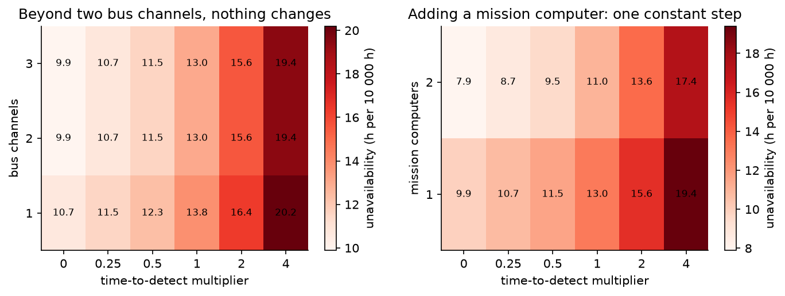
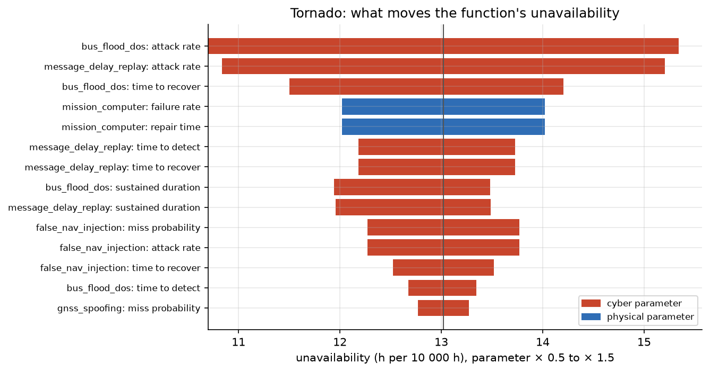
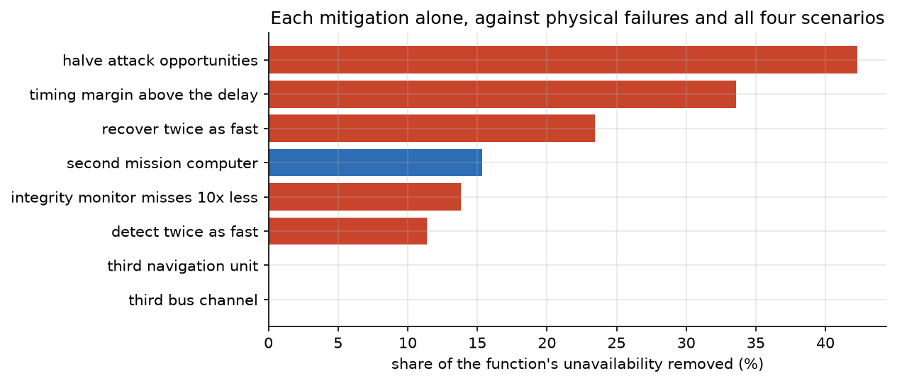

# Lesson 5 · Where mitigation money matters

> With physical failures and attacks in one model and one set of units, we can finally ask
> the question that budgets are made of: *which change buys the most of the function back?* This
> lesson sweeps redundancy against detection time, ranks every parameter with a tornado
> chart, and compares eight candidate mitigations, three physical and five cyber, on one
> scale. The answer is not "add more boxes", and the reason is structural, not a quirk of the
> numbers.

**Code:** [`src/cyberrel/sensitivity_analysis/`](../../src/cyberrel/sensitivity_analysis/) ·
**Tests:** [`tests/test_sensitivity.py`](../../tests/test_sensitivity.py) ·
**Results:** [`validation/results/sensitivity.md`](../../validation/results/sensitivity.md) ·
**Previous:** [Lesson 4](04-the-total-risk-picture.md) ·
**Next:** [Lesson 6](06-cie-in-numbers-and-what-is-new.md)

## Learning objectives

1. Separate the two levers on any failure mode, how *often* it happens and how *long* it
   lasts, and say which mitigations pull which lever.
2. Explain why physical redundancy has zero value against a common-mode attack, and where it
   still pays.
3. Compute the marginal value of faster detection from $E[\min(D, c)]$.
4. Read a tornado chart as a guide to which assumptions matter, and to where better data is
   worth paying for.
5. Compare physical and cyber mitigations in one currency, and say what a cost-benefit study
   would still need.

---

## 1. Two levers: frequency and duration

Every failure mode has a rate and a mean outage length, and availability depends on both. For
an attack scenario, Lesson 3 gave the two numbers: the equivalent MTBF (how often a denial
starts) and the equivalent MTTR (how long it lasts). Mitigations pull one lever or the other:

| lever | physical failure | cyber attack |
|---|---|---|
| **frequency** (MTBF) | better parts, derating, redundancy | hardening, reduced exposure, engineered controls that stop the effect |
| **duration** (MTTR) | spares, diagnostics, maintenance crews | detection, response, recovery |

The results show the split cleanly. Across the whole time-to-detect sweep (× 0 to × 4), the
system's unavailability doubles, from 9.9 to 19.4 hours per 10 000 h, but **its MTBF does not
move: 1 087 h in every column**. Detection and recovery decide how long an attack hurts.
They do not decide how often it starts. A program that only funds a security operations
centre buys shorter outages and the same number of them.

### The marginal value of faster detection

For a transient effect, the expected outage is $L(c) = E[\min(D, c)]$ with $c = T_d + T_r$,
and its derivative is

```math
\frac{dL}{dc} = P(D > c) .
```

So one hour less response saves $P(D > c)$ hours of outage: the share of attacks that would
still be running when the response lands. For the bus flood ($D$ exponential with mean 2 h,
$c = 1.25$ h), that share is $e^{-0.625} = 0.54$. For a *persistent* effect it is 1: every hour
of response is an hour of outage. Faster detection is worth most against effects that outlast
the response, and against persistent ones above all.

## 2. Redundancy against a common-mode attack



**Left:** rows two and three are identical to every printed digit. A third bus channel lowers
the *physical* data-path risk from $6.4 \times 10^{-9}$ to $5.1 \times 10^{-13}$ (Lesson 3),
which is invisible next to the attacks. Against the bus flood and the delay attack it does
nothing at all, because both deny the whole bus group. The test
`test_attacked_availability_is_physical_times_each_scenarios_share` proves the reason at every
grid point:

```math
A = A_{\text{physical}} \prod_s \bigl(1 - P_s(\text{deny})\bigr),
```

because every library scenario denies a whole necessary group, and the processes are
independent. Redundancy can only move the first factor.

**Right:** where physical redundancy *does* pay. The mission computer is the physical single
point of failure (99.4 % of physical system failures, Lesson 1). A second one cuts physical
unavailability from $2.0 \times 10^{-4}$ to $5.6 \times 10^{-7}$ and raises physical-only MTBF
from 19 870 h to about 3 million hours. With attacks present, it removes a constant 2.0 h per
10 000 h in every column, which is all the physical unavailability there was, but it lifts
the combined MTBF only from 1 087 h to 1 149 h. The attacks set the frequency of losses.

## 3. The tornado: which assumptions matter



Each bar moves one parameter from × 0.5 to × 1.5 and shows the function's unavailability at
the two ends:

* **The two bus attack rates come first.** They are the most uncertain numbers in the model
  (illustrative assumptions), and they matter most. That is the honest reading: *if this
  were a real program, threat-informed estimates of these rates are where analysis money
  should go first.* This is a value-of-information argument.
* **The bus flood's recovery time comes third.** It is the largest response-side lever.
* **The mission computer's failure rate and repair time come next, with identical bars.**
  Its unavailability is $\lambda \cdot \mathrm{MTTR}/(1 + \lambda \cdot \mathrm{MTTR})$, which
  depends only on the product, so halving either has the same effect.
* **Detection time of the bus flood is near the bottom.** Detection (0.25 h) is already short
  next to recovery (1 h), so the response is dominated by recovery.

**An artifact worth knowing.** For a *persistent integrity* scenario (spoofing, injection),
a longer *sustained* attack lengthens only the episodes the monitor catches, which degrade
the function without denying it. Attacks pause while an episode is running (the
alternating-process assumption of Lesson 3), so a longer caught episode delays the next
attack and *slightly reduces* denials, by about $10^{-5}$ of the baseline here. The test
suite names this exception explicitly rather than hiding it. A model in which attack
attempts keep arriving during episodes would remove it.

## 4. Eight mitigations on one scale

| mitigation | kind | unavailability removed | system MTBF × | FMC rate change |
|---|---|---|---|---|
| halve attack opportunities | cyber: hardening | 42.3 % | 1.90 | +0.07 % |
| timing margin above the delay | cyber: engineered control | 33.6 % | 1.48 | 0 |
| recover twice as fast | cyber: recovery | 23.5 % | 1.00 | +0.03 % |
| second mission computer | physical redundancy | 15.3 % | 1.06 | −0.02 % |
| integrity monitor misses 10× less | cyber: engineered control | 13.8 % | 1.07 | +0.01 % |
| detect twice as fast | cyber: detection | 11.4 % | 1.00 | +0.01 % |
| third navigation unit | physical redundancy | 0.0 % | 1.00 | −0.06 % |
| third bus channel | physical redundancy | 0.0 % | 1.00 | −0.01 % |



Reading it:

* **Engineered controls compete with hardening.** The "timing margin" is a design change:
  the consumer is built to tolerate 100 ms of latency instead of 50 ms. It removes the delay
  scenario's denial entirely, a third of all unavailability, and it is the second-best item.
  This is CIE's *engineered controls* and *design simplification* principles in numbers:
  engineering the consequence out beats watching for it.
* **Only frequency levers raise MTBF.** Hardening (× 1.90), the timing margin (× 1.48) and the
  better monitor (× 1.07) make losses rarer. Faster detection and recovery leave MTBF at
  × 1.00, as Section 1 predicts.
* **Physical redundancy pays only where the physical single point of failure is.** The
  second mission computer is worth 15 %. The third navigation unit and third bus channel are
  worth nothing against this threat picture, and both *lower* the FMC rate, because more boxes
  mean more boxes in the shop (Lesson 1).

## 5. Why there are no costs here

A mitigation ranking without costs is half a cost-benefit analysis, deliberately. Costs are
specific to each programme: hardware, certification, integration, people and time. Invented
ones would turn a structural result into a fake business case. What the model provides is
the **benefit side in reliability units**. For example, unavailability removed × fleet hours
= hours of mission capability restored. A real study divides that by real costs, and replaces
the illustrative attack rates with threat-informed estimates, starting with the parameters at
the top of the tornado.

## 6. Code walkthrough

```python
from cyberrel.attack_scenario_library import load_scenarios
from cyberrel.sensitivity_analysis import (
    Design,
    evaluate_mitigations,
    redundancy_detection_grid,
    tornado,
)
from cyberrel.system_model import navigation_system

scenarios = list(load_scenarios().values())
grid = redundancy_detection_grid(scenarios, bus_channels=(1, 2, 3), detect_scales=(0, 1, 4))
for p in grid:
    print(p.design.bus_channels, p.design.detect_scale, p.combined.unavailability)

for bar in tornado(navigation_system(), scenarios)[:5]:
    print(bar.parameter, bar.low, bar.high)

mine = ("my change", "cyber: recovery", Design(recover_scale=0.25, bus_channels=3))
for r in evaluate_mitigations(scenarios, [mine]):
    print(r.name, r.unavailability_reduction, r.mtbf_gain)
```

A `Design` bundles redundancy (`egi_units`, `bus_channels`, `mission_computers`) with
defender-side changes (`detect_scale`, `recover_scale`, `rate_scale`, `miss_scale`,
`deadline_ms`) and evaluates exactly with `combined_steady_state`.

## Exercises

1. For the bus flood ($D$ exponential, mean 2 h, $T_r = 1$ h), how much shorter is the
   expected outage if detection drops from 0.25 h to zero?
2. Why does "detect twice as fast" leave system MTBF unchanged, while "halve attack
   opportunities" almost doubles it?
3. Show that for $\lambda \cdot \mathrm{MTTR} \ll 1$ a component's unavailability is about
   $\lambda \cdot \mathrm{MTTR}$, and explain the identical tornado bars of the mission
   computer.
4. For the 24-platform, 10-year fleet of Lesson 4 (2 102 400 platform-hours), how many hours
   of mission capability does "halve attack opportunities" restore?
5. A programme can afford exactly one change: a third bus channel or recovery twice as fast.
   What do the results say, and what must be known before deciding?
6. Why does the third navigation unit lower the FMC rate?

### Solutions

1. $L(1.25) = 2(1 - e^{-0.625}) = 0.930$ h and $L(1.0) = 2(1 - e^{-0.5}) = 0.787$ h. The
   expected outage is 0.143 h (15 %) shorter.
2. Detection shortens each outage but does not change how often attacks start, so the failure
   frequency $\omega$ is unchanged and $\mathrm{MTBF} = A/\omega$ moves only through the tiny
   change in $A$. Halving attack opportunities halves the cyber part of $\omega$, which is
   most of it.
3. $1 - A = \lambda \mathrm{MTTR}/(1 + \lambda \mathrm{MTTR}) \approx \lambda \mathrm{MTTR}$.
   Scaling either factor by 0.5 or 1.5 scales the product the same way, so the bars are
   identical. For the mission computer,
   $\lambda \mathrm{MTTR} = 5 \times 10^{-5} \times 4 = 2 \times 10^{-4}$.
4. $(1.302 - 0.7515) \times 10^{-3} \times 2.1024 \times 10^{6} = 1157$ hours.
5. Against this threat picture, the third channel buys nothing (common mode) and faster
   recovery buys 23.5 % of unavailability. Before deciding: the real cost of each, and
   threat-informed attack rates, since the ranking rests on the bus attacks being frequent.
   The structural part holds regardless: a channel on the same shared medium never helps
   against a denial of that medium.
6. FMC needs *every* component up. A third unit adds one more component that is sometimes
   in repair, so the share of time with everything up falls, even though the function is up
   more.

## References

* V. L. Wright *et al.*, *Cyber-Informed Engineering Implementation Guide*, INL/RPT-23-74072,
  2023: principles 2 (*engineered controls*), 4 (*design simplification*), 5 (*layered
  defenses*), 6 (*active defense*) and 10 (*planned resilience*).
* M. Rausand and A. Høyland, *System Reliability Theory*, 2nd ed., Wiley, 2004: importance
  measures and sensitivity (ch. 5).
* A. Saltelli *et al.*, *Global Sensitivity Analysis: The Primer*, Wiley, 2008: one-at-a-time
  sensitivity and its limits.
* R. A. Howard, "Information value theory", *IEEE Transactions on Systems Science and
  Cybernetics*, 2(1), 1966: the value of better information.
