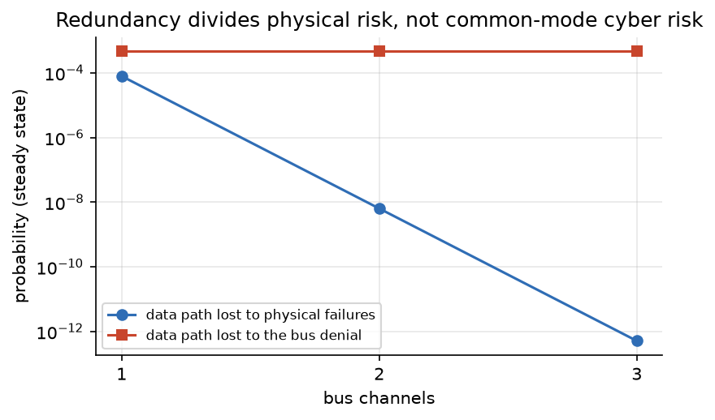
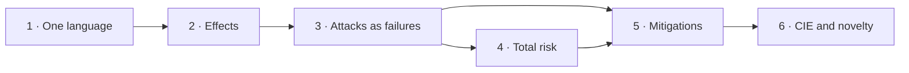

# Cyber attacks in reliability units: the course

Six lessons that put cyber attacks into the language reliability engineers already speak:
MTBF, MTTR, availability and mission-capable rate. They start from the classical physical
baseline, describe attacks by their effect, translate them into failure modes, simulate a fleet
with both, price mitigations on one scale, and end with an honest look at assumptions and
novelty. Each lesson derives the method, walks through the code in this repository, checks it
against closed forms or independent computations, applies it to the same synthetic navigation
system, and ends with exercises (answers included).

## Lessons

| # | Lesson | You will learn | Key result |
|---|---|---|---|
| 1 | [One language for failure](01-one-language-for-failure.md) | alternating renewal, availability, system failure frequency via Birnbaum importance, mission reliability, FMC/PMC/NMC | physical A = 0.9998 and system MTBF 19 870 h; the mission computer causes 99.4 % of system failures; CPS-02 agrees to 1e-12 |
| 2 | [Describing an attack by what it does](02-describing-an-attack-by-what-it-does.md) | denial, integrity and delay effects; transient and persistent episodes; $E[\min(D, c)]$; common mode; ATT&CK as vocabulary | the bus flood's expected outage is 0.93 h, capped by the response time |
| 3 | [A cyber attack as a failure event](03-a-cyber-attack-as-a-failure-event.md) | attacks as renewal processes, equivalent MTBF/MTTR, exact joint-state metrics, the series-block identity | the bus flood alone costs 2.3× the physical unavailability; a third bus channel changes nothing against it |
| 4 | [The total risk picture](04-the-total-risk-picture.md) | discrete-event simulation by segments, outage logs, keyed random streams, confidence intervals across platforms | 24 platforms, 10 years: 1 790 cyber vs 95 physical losses; fleet MTBF 22 130 h → 1 114 h |
| 5 | [Where mitigation money matters](05-where-mitigation-money-matters.md) | frequency vs duration levers, the marginal value of detection, tornado charts, mitigations on one scale | detection leaves MTBF at 1 087 h; halving attack opportunities removes 42 %, a third bus channel 0 % |
| 6 | [Cyber-Informed Engineering in numbers, and what is new](06-cie-in-numbers-and-what-is-new.md) | the twelve CIE principles, the assumptions behind every number, positioning against related work | ten principles touched quantitatively or by design; structural results survive any attack rates |

Read them in order. Lessons 4 and 5 can be read in either order after Lesson 3.

## Prerequisites

* Probability: independence, expectation, the exponential distribution, conditional
  probability.
* Reliability basics help (MTBF, series and parallel systems); Lesson 1 reviews them.
* Python with NumPy, to follow the code walkthroughs.

## How to use it

* Every lesson links its code, tests and results. The numbers in the lessons come from
  [`validation/results/`](../../validation/results/), regenerated by
  `uv run python validation/run_all.py`.
* Each lesson has an executed [notebook](../../notebooks/) that reproduces its main results.
* The [report](../report.md) is the short version for readers who want the findings, not the
  derivations.
